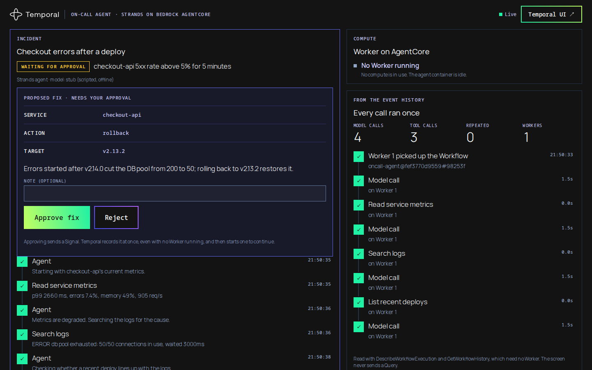

# Booth integration: AgentCore On-Call

The research placeholder is replaced by this on-call agent. See [UPSTREAM.md](UPSTREAM.md) for the import commit and booth changes.

From the monorepo root, run `scripts/local.sh up --apps agentcore-research --port 15101`, then open `http://localhost:15101/?demo=agentcore-research`. The retained station key preserves existing booth configuration. The app route is `/agentcore-oncall/`.

Local mode runs real Temporal Workflows with the upstream offline scripted model. The local invoker starts and drains the worker; it is not AWS AgentCore or Bedrock. Pick an incident, wait for its proposal, then approve or reject. Tap the optional note field for the booth's QWERTY keyboard.

Hosted starts remain disabled in both launchpad and API until the pinned Fieldkit platform can provision AgentCore and its Bedrock grant. The API lives in the single root deployment. The upstream resource below is retained as a reference, not a separate deployment.

---

# On-call agent on AgentCore

An AI on-call agent diagnoses an incident, proposes a fix and waits as long as it takes for a person
to approve it, with no compute running while it waits. Then it picks up exactly where it stopped.
Your Strands agent, made durable with Temporal, running on Amazon Bedrock AgentCore.



## What's in it

- [Serverless Workers on AgentCore](https://docs.temporal.io/develop/python/workers/serverless-workers/agentcore):
  the agent's Worker runs only while there is work. Temporal Cloud invokes it when a task arrives
  and no Worker is polling; it drains once idle and AgentCore ends the session.
- [Durable Execution](https://docs.temporal.io/workflows) of an agent: every model call and tool call
  is an [Activity](https://docs.temporal.io/activities) recorded in the Event History, so a new
  process resumes the agent without calling the model again.
- Human in the loop with a [Signal](https://docs.temporal.io/sending-messages#sending-signals): the
  approval is recorded with no Worker running, and recording it is what starts one.
- [Worker Versioning](https://docs.temporal.io/worker-versioning) with Pinned Workflows: an incident
  finishes on the code it started on.
- A UI that reads state with Describe, the memo, a
  [Search Attribute](https://docs.temporal.io/search-attribute) and the Event History. It never sends
  a [Query](https://docs.temporal.io/sending-messages#sending-queries), which would need a running
  Worker.

## How it works

```mermaid
%%{init: {"theme": "base", "sequence": {"mirrorActors": false, "boxMargin": 8, "noteMargin": 12, "messageMargin": 38}, "themeVariables": {
  "fontSize": "15px",
  "textColor": "#1ff1a5",
  "background": "#141414",
  "actorBkg": "#141414",
  "actorBorder": "#444ce7",
  "actorTextColor": "#f8fafc",
  "actorLineColor": "#465a78",
  "signalColor": "#1ff1a5",
  "signalTextColor": "#f8fafc",
  "labelBoxBkgColor": "#1a1830",
  "labelBoxBorderColor": "#7f86f1",
  "labelTextColor": "#cacbf9",
  "loopTextColor": "#cacbf9",
  "noteBkgColor": "#1a1830",
  "noteBorderColor": "#7f86f1",
  "noteTextColor": "#f8fafc",
  "activationBkgColor": "#1a1830",
  "activationBorderColor": "#1ff1a5"
}}}%%
sequenceDiagram
  rect rgb(20, 20, 20)
  participant eng as On-call engineer
  participant api as API (Go)
  participant t as Temporal
  box rgb(26, 24, 48) YOUR AWS ACCOUNT
  participant w as Worker on AgentCore<br/>Strands agent
  participant br as Bedrock
  end

  eng->>api: ① Report an incident
  api->>t: Start IncidentWorkflow
  t->>w: ② Invoke: work on the Task Queue, no Worker
  w->>t: Poll, run the Workflow
  loop Every model call and tool call is an Activity
    w->>br: ③ Model call
    w->>w: Tool: metrics, logs, deploys
  end
  w->>t: ④ Agent proposes apply_remediation:<br/>hook interrupt, wait for a Signal
  Note over w: ⑤ Idle: the Worker drains,<br/>AgentCore ends the session
  Note over t: Waits up to 24 h,<br/>no compute running
  eng->>api: ⑥ Approve
  api->>t: Signal decide
  t->>w: ⑦ Invoke a new Worker
  w->>t: Poll, replay history,<br/>resume from the proposal
  w->>w: ⑧ Apply the fix (Activity)
  w->>t: Workflow completes
  end
```



1. The on-call engineer reports an incident, and the API starts an `IncidentWorkflow`.
2. The Task Queue has work and no Worker polling it, so Temporal invokes the Worker on AgentCore.
3. The Strands agent reads metrics, logs and recent deploys. Each model call and each tool call
   runs as an Activity.
4. The agent proposes `apply_remediation`. A hook interrupt stops it there, and the Workflow waits
   for a Signal.
5. With nothing to run, the Worker drains and AgentCore ends the idle session. Nothing runs while
   the Workflow waits, for up to 24 hours.
6. The engineer approves, and the API sends the `decide` Signal.
7. Temporal invokes a new Worker, which replays the history and resumes the agent at the proposal.
   No model call is repeated.
8. The fix runs as an Activity and the Workflow completes.

**From Strands Agents:** the agent itself. The system prompt, the tool definitions (built from the
tool functions' docstrings), the model loop that decides which tool to call next, the Bedrock model
provider, and the hook interrupt that stops the agent before `apply_remediation`.

**From Temporal:** what makes it durable. The
[`temporalio-strands-agents`](https://pypi.org/project/temporalio-strands-agents/) plugin runs the
Strands agent inside a Workflow (`TemporalAgent`) and turns each model call and each tool call into
an Activity, with timeouts and retries. The Workflow holds the approval wait (a Signal and a 24-hour
timer), and Temporal Cloud starts the AgentCore Worker when there is work for it.

**From AgentCore:** the compute. A runtime per Worker Deployment Version, a session per invocation,
ended after 60 idle seconds.

| Path | What |
|---|---|
| `agent/oncall/workflows.py` | The incident Workflow, the approval gate and the progress hooks |
| `agent/oncall/activities.py` | The tools: metrics, logs, deploys, apply the fix (simulated) |
| `agent/oncall/models.py` | Bedrock, or a scripted stub for offline runs |
| `agent/agentcore_worker.py` | The AgentCore entrypoint that starts and drains the Worker |
| `api/internal/oncall` | The HTTP API: start, decide, and one read for the whole screen |
| `api/web/static` | The UI |
| `api/cmd/local-invoker` | Compose only: stands in for Temporal Cloud's invoke |
| `docs/upstream-demoproject.yaml.example` | The draft catalog entry ([docs/catalog.md](docs/catalog.md)) |

## Run it

Prerequisites: Docker, Docker Compose and `make`.

```sh
make demo
```

Open http://localhost:8080. The Temporal UI is at http://localhost:8233. Locally the agent uses a
scripted stub model, and the screen says so; `RUNBOOK.md` has how to use Bedrock instead.

Presenting it, resetting it and the code behind each beat: [RUNBOOK.md](RUNBOOK.md).

## Notes

- **No crashable workspace.** The kit's baseline is a crashable copy per presenter. The platform
  never makes a project with a serverless component crashable, so this demo keeps presenters apart
  with session-scoped Workflow IDs instead ([docs/catalog.md](docs/catalog.md), 1 to 4).
- **The catalog entry waits on the platform.** The platform refuses a Bedrock grant for an AgentCore
  component until tdo-8lak.15 ([docs/catalog.md](docs/catalog.md)).
- **The plugin is `temporalio.strands_agents`.** Temporal's integration ships as the
  `temporalio-strands-agents` package; `temporalio.contrib.strands` in the SDK only re-exports it.
- **Worker status comes from Worker heartbeats,** which the Worker sends every 10 s. A Worker that
  hasn't sent one for 25 s counts as gone, because a killed Worker's last record still says Running.
- **Locally, `local-invoker` plays Temporal Cloud.** It makes the Worker Deployment Version current
  and POSTs `/invocations` when the version has backlog and no live Worker. It polls once a second,
  so it is not a model of Cloud's timing.
