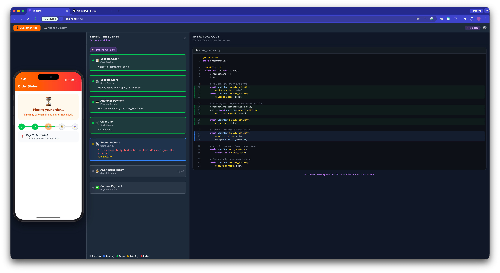
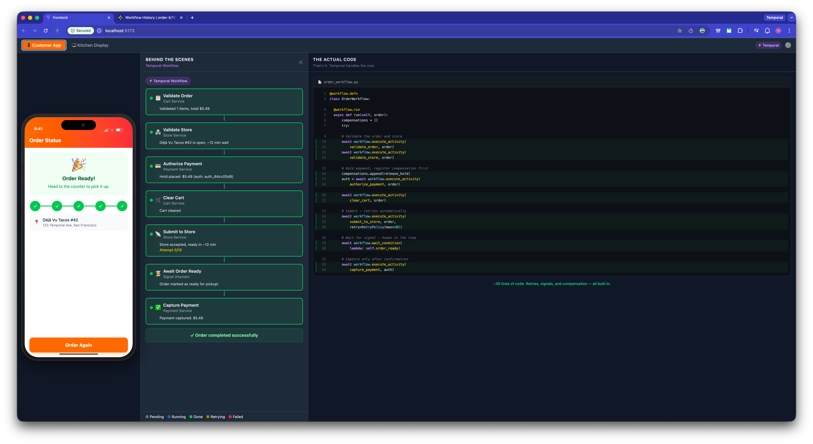
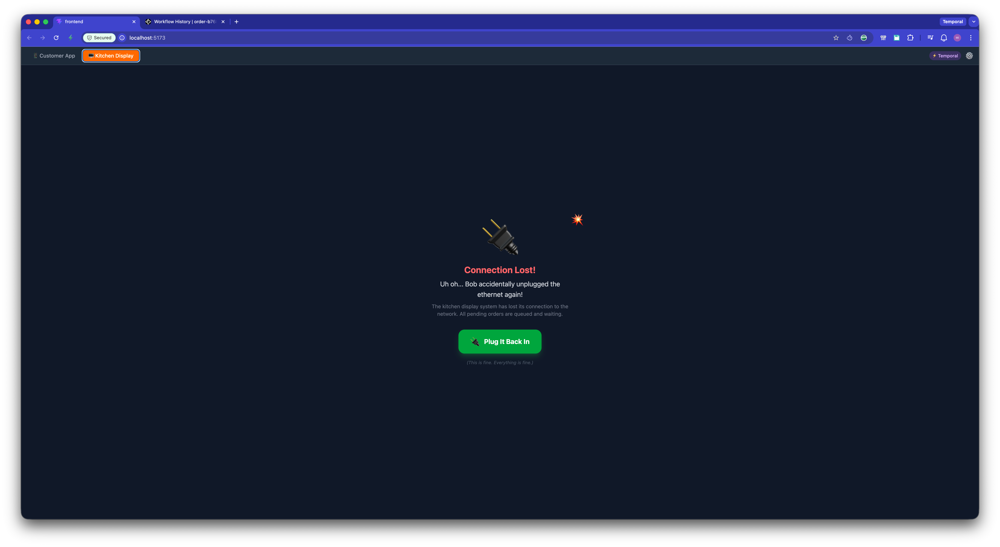
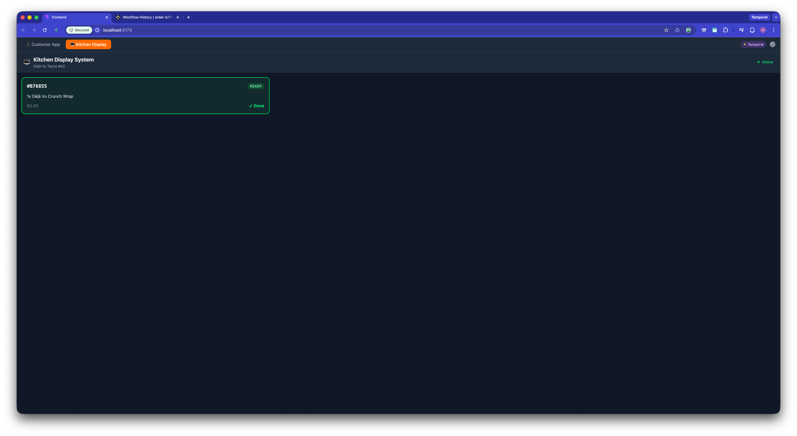
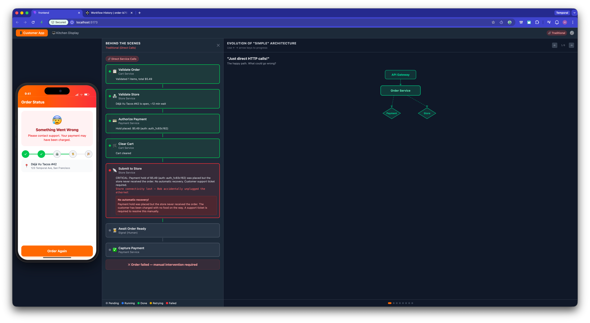
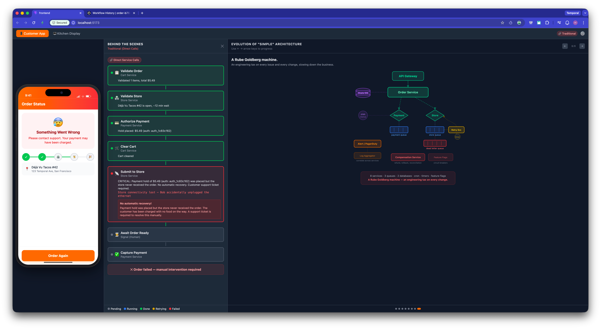
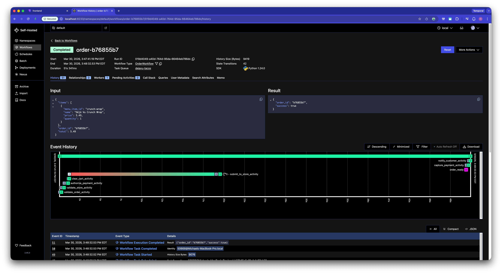

> These updates are only for AWS re:Invent 2026. This repository's main branch is the re:Invent demo version.

## Ziggy Space Taqueria (re:Invent 2026)

This reskin is only for AWS re:Invent 2026. Contact Ian Douglas or Tomas Josovsky with questions.

Ordering and kitchen controls stay visible together. The lower panel has Business impact, Architecture, Workflow code, and Temporal UI tabs. `?persona=captain`, `mech`, `envoy`, or `solarian` sets the starting tab; changing perspective or code language keeps the order running. Each panel has its own zoom buttons and two-finger zoom handler. Physical TV/stylus testing remains required; gestures inside the embedded Temporal UI belong to that app.

The UI uses Ash's Cosmic Pop theme from `_design-toolkit`. The code viewer shows the running language's full Workflow source from this build, or annotated excerpts in other languages. Swift is an explicitly illustrative outline for the [stable community SDK](https://forums.swift.org/t/temporal-swift-sdk-1-0-0/86768), with no Swift worker. It is not compiled SDK code.

### Run the complete local stack with Docker

From this repository:

```bash
docker compose -p ziggy-reskin -f compose.booth.yml up -d --build
```

Open [the demo](http://127.0.0.1:15310). This isolated stack uses Python, local Temporal, a persistent Docker volume, and ports 15310 (app), 18310 (API), 17233 (Temporal), and 18233 (Temporal UI). Existing bundle routes and the original Compose language profiles are unchanged. To use the bundle's app port, set `TACOS_UI_PORT=5310` when starting this stack after stopping any process already using it. The Config link still opens the bundle panel on port 5199; this Compose file does not start that panel.

Build images and download them before the event. Rebuilding requires registry/package network access. The local demo can run with those images cached and its local services running; physical internet-disconnect testing is still required. Stop without removing workflow data:

```bash
docker compose -p ziggy-reskin -f compose.booth.yml stop
```

### Connect the containers to Temporal Cloud

Put these values in a private env file outside Git. Use a unique task queue per station because the worker calls that station's API. Never paste keys into browser settings or build arguments.

```dotenv
TEMPORAL_ENDPOINT=your-namespace.your-account.tmprl.cloud:7233
TEMPORAL_NAMESPACE=your-namespace.your-account
TEMPORAL_API_KEY=replace-with-your-key
TACOS_TASK_QUEUE=ziggy-tacos-station-1
```

```bash
docker compose --env-file /absolute/private/booth.env -p ziggy-reskin -f compose.booth.yml -f compose.cloud.yml up -d --build
```

The local Temporal container stays running as a fallback. To switch back, exit the current demo, start with only `compose.booth.yml`, then reload the browser and start a new order. The local file explicitly clears Cloud endpoint/auth settings. Switching targets does not migrate or resume existing Cloud workflows locally. Cloud credentials and end-to-end Cloud execution remain unverified.

The Temporal tab uses the backend's namespace/execution links. Local embedding is optional and uses `/temporal-ui/` on the app origin, preserving Temporal UI framing headers. The direct local UI is also available at `http://127.0.0.1:18233/temporal-ui/`. Cloud opens in another browser tab for login; no authentication bypass or framing workaround is included.

### Container checks

```bash
docker build --target build -f docker/frontend.Dockerfile -t ziggy-tacos-check .
docker run --rm ziggy-tacos-check npm test
docker run --rm ziggy-tacos-check npm run lint
```

The image build runs the TypeScript check and Vite production build. Before an event, exercise a real order: submit while the kitchen is offline, inspect retries, restore the kitchen uplink, then mark it ready and verify payment capture. See `RUNBOOK.md` for the original scenarios; its old customer/kitchen tab navigation now corresponds to the two upper panels.

> Contact Ian Douglas or Tomas Josovsky with questions.

# Déjà Vu Tacos — Temporal Order Management Demo

A live, interactive demo showing why [Temporal](https://temporal.io) matters for order management. Place a taco order through an iPhone-style app, watch the behind-the-scenes workflow execute in real time, and see what happens when things go wrong.

Toggle between **Traditional mode** (direct service calls, no recovery) and **Temporal mode** (durable workflows with retries, signals, and compensation) — same failure, wildly different outcomes.



## Quick Start

**Prerequisites:** [Temporal CLI](https://docs.temporal.io/cli) + either Docker or the language-specific toolchain for local mode.

```bash
./scripts/start.sh              # Python worker (default)
./scripts/start.sh go           # Go worker
./scripts/start.sh typescript   # TypeScript worker
./scripts/start.sh java         # Java worker
./scripts/start.sh dotnet       # .NET (C#) worker
./scripts/start.sh rust         # Rust worker
./scripts/start.sh php          # PHP worker
./scripts/start.sh ruby         # Ruby worker
```

The script auto-detects your environment:

| Has Docker? | What happens |
|---|---|
| Yes | Temporal CLI on host, backend/worker/frontend in containers |
| No | Everything runs locally as background processes |

Open http://localhost:5173 once it's running. Temporal UI at http://localhost:8233.

To present the demo, follow [RUNBOOK.md](RUNBOOK.md): the walkthrough beat by beat, and where in the code each part happens.

## The Demo

### 1. Place an order (Temporal mode)

Browse the menu, add items, and check out. The behind-the-scenes panel shows each workflow activity executing. The code panel on the right shows the actual workflow code — in the language of the running worker — lighting up in real time.



### 2. Simulate a failure

With the default "Store Connectivity" failure scenario, the store loses connection after payment is authorized. Switch to the **Kitchen Display** tab to see what happened:



Click **"Plug It Back In"** — the Temporal workflow's retry policy picks up the recovery automatically. The order appears on the KDS, and you can mark it ready:



### 3. Compare with Traditional mode

Switch to Traditional mode in settings (the path button at the top right, which reads **Temporal · Store connectivity**) and place the same order. When the store goes down, the order fails — payment is taken but no food is coming. No retries, no compensation, no recovery.



### 4. See the architecture contrast

Use the **arrow keys** to step through the "Evolution of Simple Architecture" diagram, showing the Rube Goldberg machine of queues, retry services, dead letter queues, state databases, and cron jobs that you'd need to build for reliability without Temporal.



### 5. Inspect the real workflows

The Temporal UI at http://localhost:8233 shows actual workflow executions with full event history:



## Settings

Click the path button at the top right (it shows the current architecture and failure scenario) to configure:
- **Architecture Mode**: Traditional (fragile) vs Temporal (durable)
- **Failure Scenario**: Store connectivity (default), payment error, random chaos, or none
- **Presentation Mode**: Simple (high-level) vs Detailed (retries, payloads, error messages)

## Architecture

```
Browser (React + Vite + nginx)
    ↓ REST + SSE
FastAPI Backend (Python)
    ├── Mock Services (payment, store, cart)
    ├── Internal API (failure state, SSE events, store orders)
    └── Temporal client (starts workflows, sends signals)
           ↕
Temporal Dev Server (CLI, on host)
           ↕
Worker (Python, Go, TypeScript, Java, .NET, Rust, PHP, or Ruby — swappable)
    ├── OrderWorkflow (saga compensation, signals, queries)
    └── Activities → Backend internal API
```

The worker runs as a separate process from the backend. Activities call the backend's internal API for failure state and store order registration, so the worker can be killed and restarted without losing sync — demonstrating Temporal's durable execution.

## Multi-Language Support

The same workflow is implemented in all eight languages with a Temporal SDK. The backend is decoupled from the worker: it starts workflows and sends signals by string name, so any language's worker can be swapped in.

| Language | Run with | Saga Pattern |
|---|---|---|
| Python | `./scripts/start.sh python` | Manual compensation list + `asyncio.shield` |
| Go | `./scripts/start.sh go` | `Compensations` struct + `NewDisconnectedContext` |
| TypeScript | `./scripts/start.sh typescript` | Manual compensation list + `CancellationScope.nonCancellable()` |
| Java | `./scripts/start.sh java` | SDK's built-in `Saga` class (first-class support) |
| .NET (C#) | `./scripts/start.sh dotnet` | Manual compensation list with try/catch |
| Rust | `./scripts/start.sh rust` | Manual compensation list + detached `WorkflowCancellationToken` |
| PHP | `./scripts/start.sh php` | SDK's built-in `Saga` class, run by RoadRunner |
| Ruby | `./scripts/start.sh ruby` | Manual compensation list + detached `Cancellation` |

All workers implement the same flow: validate → authorize payment → clear cart → submit to store → wait for ready signal → capture payment. Same task queue (`dejavu-tacos`), same signal names, same compensation behavior.

The code view opens on the active worker's language, with a tab per language to compare them. To add a new language, see [Adding a New Language](#adding-a-new-language).

## Project Structure

```
├── frontend/             # React + Vite + TypeScript + Tailwind
│   └── src/data/         # Language-specific code definitions for the code viewer
├── backend/              # FastAPI + mock services (always Python)
├── workflows/
│   ├── python/           # Python worker — temporalio SDK
│   ├── go/               # Go worker — go.temporal.io/sdk
│   ├── typescript/       # TypeScript worker — @temporalio/* packages
│   ├── java/             # Java worker — io.temporal:temporal-sdk
│   ├── dotnet/           # .NET worker — Temporalio NuGet package
│   ├── rust/             # Rust worker — temporalio-sdk crate
│   ├── php/              # PHP worker — temporal/sdk on RoadRunner
│   └── ruby/             # Ruby worker — temporalio gem
├── docker/               # Dockerfiles + nginx config
├── docker-compose.yml    # Container orchestration (one profile per language)
└── scripts/start.sh      # One-command launcher
```

## Running with Docker

```bash
# Start with a specific worker language
DEJAVU_WORKER_LANGUAGE=go docker compose --profile go up --build

# Or use the launch script (handles Temporal dev server too)
./scripts/start.sh typescript
```

Docker Compose profiles: `python`, `go`, `typescript`, `java`, `dotnet`, `rust`, `php`, `ruby`. Only the selected worker starts.

## Running Locally

The launch script falls back to local mode if Docker isn't available:

```bash
./scripts/start.sh python       # needs: uv, npm, temporal
./scripts/start.sh go           # needs: go, npm, temporal
./scripts/start.sh typescript   # needs: node/npm, temporal
./scripts/start.sh java         # needs: gradle, jdk 17+, npm, temporal
./scripts/start.sh dotnet       # needs: dotnet 8+, npm, temporal
./scripts/start.sh rust         # needs: rust 1.92+, protoc, npm, temporal
./scripts/start.sh php          # needs: php 8.4+ with sockets, composer, rr, npm, temporal
./scripts/start.sh ruby         # needs: ruby 3.4, bundler, npm, temporal
```

## Development

```bash
# Install dependencies
uv sync && cd frontend && npm install

# Run individual services
temporal server start-dev                                                        # Temporal on :7233
uv run --package dejavu-tacos-backend server                                     # FastAPI on :8000
DEJAVU_BACKEND_URL=http://localhost:8000 uv run --package dejavu-workflows worker # Python worker
cd workflows/go && DEJAVU_BACKEND_URL=http://localhost:8000 go run ./cmd/worker/ # Go worker
cd workflows/typescript && npm run build && DEJAVU_BACKEND_URL=http://localhost:8000 node lib/worker.js
cd workflows/java && DEJAVU_BACKEND_URL=http://localhost:8000 gradle run
cd workflows/dotnet && DEJAVU_BACKEND_URL=http://localhost:8000 dotnet run
cd workflows/rust && DEJAVU_BACKEND_URL=http://localhost:8000 cargo run --release
cd workflows/php && composer install && DEJAVU_BACKEND_URL=http://localhost:8000 rr serve -c .rr.yaml
cd workflows/ruby && bundle install && DEJAVU_BACKEND_URL=http://localhost:8000 bundle exec ruby worker.rb
cd frontend && npm run dev                                                       # Vite on :5173
```

## Order Flow

1. **Validate Order** — check items and prices
2. **Validate Store** — confirm store is open
3. **Authorize Payment** — place a hold (not a capture)
4. **Clear Cart** — commit the order
5. **Submit to Store** — send to kitchen (retries on failure)
6. **Await Order Ready** — signal from KDS (human in the loop)
7. **Capture Payment** — charge only after store confirms

**Compensation (saga pattern):** If store submission fails permanently, the workflow automatically releases the payment hold and notifies the customer. No manual intervention needed.

## Adding a New Language

1. Implement the workflow in `workflows/<lang>/` — same activity event names, same task queue
2. Add code definition in `frontend/src/data/workflowCode.ts` (code lines, compensation lines, syntax highlighting)
3. Add a Dockerfile in `docker/worker-<lang>.Dockerfile`
4. Add a profile in `docker-compose.yml`
5. Add a case in `scripts/start.sh`
6. Add to `WorkerLanguage` type in `frontend/src/types/index.ts`
