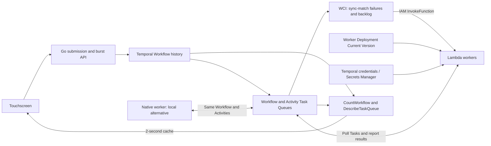

# No Roads Architecture Panel

Replace the generic six-box diagram with a diagram specific to No Roads. Show submission and burst APIs, durable history, Workflow and Activity Task Queues, the Worker Controller (WCI), IAM invocation, Worker Deployment Version, Lambda worker slots, authentication, and dashboard metrics. Keep all of it within the existing lower panel.

Only the selected workflow's Activity is highlighted from recorded history. WCI decisions and Lambda invocation counts are not inferred from that workflow's cursor. Read `/no-roads/api/runtime` to show the active native worker locally and mark the hosted AWS path as illustrative.

Each job runs ProcessSubmission, SimulateWork1, SimulateWork2, and SimulateWork3. Each simulated work Activity holds a slot for 4 seconds; default worker concurrency is five Activities. Lambda invocations poll until their shutdown deadline rather than disappearing immediately when the backlog reaches zero. Dashboard Lambda estimates come from Temporal pollers, not CloudWatch concurrency.

Sources: `apps/no-roads/shared/workflows/demo_workflow.go`, `shared/activities/demo_activities.go`, `shared/workerconfig/workerconfig.go`, `lambda-worker/main.go`, `demo-app/api/metrics.go`, and the demo runbook. Lifecycle and scaling were checked against https://docs.temporal.io/serverless-workers/aws-lambda and https://docs.temporal.io/develop/go/workers/serverless-workers/aws-lambda.

Workflow links explicitly activate the lower Temporal UI panel and return its nested scroll regions to the top, even when that run is already selected. Background workflow announcements preserve the current scroll. The panel starts at 100% rather than 120% and exposes touch zoom controls from 70% to 130%, with a 100% reset. Only the iframe is scaled; the upper demo and browser zoom stay unchanged.
